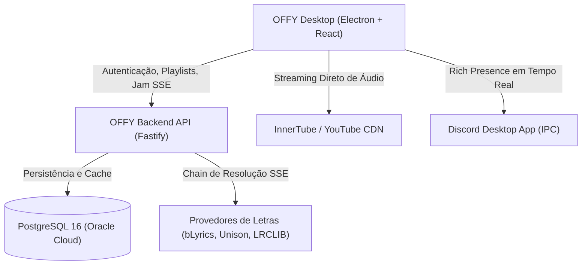
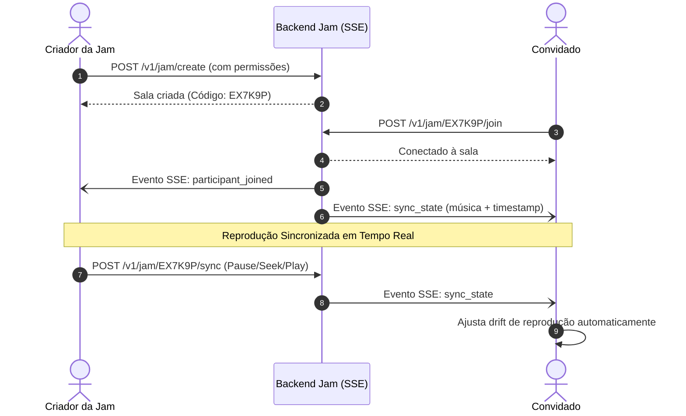

# 🎵 Documentação Oficial — OFFY Music Player

<div align="center">


**O reprodutor de música desktop moderno, rápido, sem anúncios e com sincronização coletiva.**

[](https://github.com/Gebe-0/offy-app)
[](https://github.com/Gebe-0/offy-app)
[](https://discord.com)
[](https://github.com/Gebe-0/offy-app)

</div>

---

## 📑 Índice de Navegação

1. [Visão Geral e Arquitetura](#1-visão-geral-e-arquitetura)
2. [Motor de Áudio e Streaming](#2-motor-de-áudio-e-streaming)
3. [Equalizador de 10 Bandas, Velocidade e Pitch](#3-equalizador-de-10-bandas-velocidade-e-pitch)
4. [Sistema de Jam (Sessões Coletivas em Tempo Real)](#4-sistema-de-jam-sessões-coletivas-em-tempo-real)
5. [Letras Sincronizadas Word-Level (Karaokê)](#5-letras-sincronizadas-word-level-karaokê)
6. [Biblioteca, Playlists e Importação](#6-biblioteca-playlists-e-importação)
7. [Discord Rich Presence (RPC)](#7-discord-rich-presence-rpc)
8. [Atalhos de Teclado](#8-atalhos-de-teclado)
9. [Perguntas Frequentes (FAQ)](#9-perguntas-frequentes-faq)
10. [Suporte e Comunidade](#10-suporte-e-comunidade)

---

## 1. Visão Geral e Arquitetura

O **OFFY** é um ecossistema musical de alto desempenho desenvolvido para proporcionar uma experiência de áudio rica, sem interrupções e com recursos avançados de customização sonora e audição sincronizada com amigos.

### Estrutura do Monorepo

```
offy/
├── apps/
│   ├── api/            # Servidor Fastify + PostgreSQL (Oracle Cloud VM) — Auth, Catálogo, Letras, Jam, Social
│   └── client/         # Cliente Desktop OFFY (Electron + React + Vite + Tailwind CSS)
├── packages/
│   ├── core/           # Módulos centrais de resolução InnerTube, busca e streaming
│   └── contracts/      # Definições de tipos e contratos de API compartilhados (TypeScript)
├── migrations/         # Esquemas SQL versionados do banco de dados
├── scripts/            # Scripts de automação, migração e manutenção
└── DOCUMENTATION.md    # Esta documentação completa do projeto
```

### Arquitetura de Alto Nível



> [!NOTE]
> **Zero Proxy de Áudio:** O tráfego de mídia não sobrecarrega a API. O cliente resolve e recebe o stream de áudio diretamente dos CDNs de alta velocidade, garantindo tempo de resposta instantâneo e ausência de gargalos.

---

## 2. Motor de Áudio e Streaming

O motor de áudio do OFFY foi projetado para alta fidelidade e resiliência:

- **Resolução Descentralizada:** Cada cliente negocia seus próprios streams utilizando a biblioteca InnerTube.
- **Perfis com Fallback Inteligente:**
  1. `WEB_REMIX` — Catálogo e metadados primários.
  2. `VISIONOS` & `ANDROID_VR` — Perfis de áudio de alta qualidade sem restrições ou necessidade de PO Token no servidor.
- **Cache Inteligente de Faixas:** Músicas reproduzidas são temporariamente armazenadas em cache local para evitar re-downloads desnecessários e permitir avanço rápido (_instant scrubbing_).
- **Pre-buffering da Próxima Música:** A próxima faixa da fila começa a ser carregada antes do término da faixa atual, eliminando pausas perceptíveis entre músicas.

---

## 3. Equalizador de 10 Bandas, Velocidade e Pitch

O processador de áudio do OFFY opera diretamente na **Web Audio API** através de filtros `BiquadFilterNode` encadeados.

### As 10 Bandas de Frequência

| Frequência | Faixa Sonora    | Impacto no Som                                            |
| :--------- | :-------------- | :-------------------------------------------------------- |
| **32 Hz**  | Sub-Bass        | Sensação física de graves profundos e vibrações subgraves |
| **64 Hz**  | Bass            | Peso de bumbos de bateria e baixos elétricos              |
| **125 Hz** | Low-Mid         | Calor e corpo da mixagem                                  |
| **250 Hz** | Médios Graves   | Transição entre graves e vocais                           |
| **500 Hz** | Médios          | Clareza de instrumentos acústicos e harmônicos            |
| **1 kHz**  | Médios Centrais | Foco e presença dos vocais principais                     |
| **2 kHz**  | Upper-Mid       | Ataque de guitarras, caixas de bateria e dicção vocal     |
| **4 kHz**  | Presença        | Clareza e corte na mixagem geral                          |
| **8 kHz**  | Brilho          | Detalhe de pratos, chimbais e ar acústico                 |
| **16 kHz** | Arejo (Air)     | Extensão ultra-alta e espacialidade da gravação           |

### Presets Sonoros Integrados

- **Flat:** Resposta linear original de estúdio.
- **Bass Boost:** Reforço acentuado nas frequências de 32 Hz a 125 Hz para graves potentes.
- **Vocal Focus:** Realce em 1 kHz – 4 kHz para destacar letras e podcasts.
- **Eletrônica / EDM:** Curva em V com sub-graves encorpados e agudos brilhantes.
- **Rock:** Presença de médios e ataque nas frequências de 500 Hz – 2 kHz.

### Modificador de Velocidade e Pitch

- Ajuste a velocidade de reprodução entre **0.5x e 2.0x** sem distorcer o tom vocal (preservação de formantes e pitch-shifting).

---

## 4. Sistema de Jam (Sessões Coletivas em Tempo Real)

O **OFFY Jam** permite que você e seus amigos ouçam músicas exatamente no mesmo segundo, independentemente de onde estejam.



### Funcionalidades da Jam:

- **Código de Sala Único:** Código alfanumérico curto de 6 caracteres (ex: `A9K3P2`) e links diretos para compartilhamento.
- **Painel de Permissões para o Host:**
  - ✅ _Permitir que convidados alterem a música._
  - ✅ _Permitir que convidados pausem ou retomem._
  - ✅ _Permitir que convidados adicionem e organizem a fila de reprodução._
- **Sincronização Ativa Anti-Drift:** O cliente monitora continuamente a discrepância de tempo entre os participantes e compensa milissegundos suavemente sem cortes bruscos.
- **Re-sincronização no Foco:** Ao alternar de volta para o app após usar outros programas, o OFFY revalida imediatamente o estado da Jam.
- **Contador ao Vivo:** Badge dinâmica no menu lateral exibindo quantos ouvintes estão na sala no momento.
- **Toasts Informativos:** Avisos automáticos quando novos ouvintes entram ou se desconectam da sessão.

---

## 5. Letras Sincronizadas Word-Level (Karaokê)

O OFFY conta com um dos sistemas de letras mais avançados do mercado:

### Cascata de Provedores de Letras

1. **bLyrics (Better Lyrics):** Letras sincronizadas **palavra por palavra** (formato TTML) com animação suave de karaokê.
2. **Unison:** Pareamento exato pela faixa original.
3. **Portato & Binimum:** Bases de dados asiáticas e globais de alta cobertura.
4. **LRCLIB Synced:** Linha por linha tradicional.
5. **LRCLIB Plain:** Texto integral como último fallback.

### Interface em Tela Cheia (_Fullscreen Player_)

- Ative com a tecla <kbd>F</kbd> ou pelo ícone de tela cheia.
- Fundo dinâmico com **WebGL Shaders** que reagem harmonicamente às cores dominantes da arte do álbum.
- Rolagem automática suave para acompanhar a voz do artista.
- Tradução simultânea de letras disponível quando suportado pelo idioma da faixa.

---

## 6. Biblioteca, Playlists e Importação

### Isolamento Estrito de Contas

- **Zero Contaminação de Dados:** Cada usuário possui um identificador único e suas preferências, músicas salvas, histórico e mixes diários são 100% isolados. Ao baixar ou instalar o aplicativo em um novo computador, nenhum dado de outro usuário é importado.

### Importador Universal de Playlists

Traga suas músicas de outros serviços sem esforço:

- **Spotify:** Importação de links públicos de playlists, álbuns e faixas.
- **Apple Music:** Conversão direta de catálogos e playlists.
- **YouTube / YouTube Music:** Reconhecimento instantâneo de links e listas de reprodução.

---

## 7. Discord Rich Presence (RPC)

Conecte sua atividade no OFFY diretamente ao seu perfil do Discord:

- **Status em Tempo Real:** Exibe o nome da faixa, artista, capa do álbum e barra de progresso.
- **Status Jam Coletiva:** Mostra quando você está ouvindo com amigos em uma sessão Jam.
- **Botão de Acesso Rápido:** Permite que amigos no Discord vejam o que você está escutando.

---

## 8. Atalhos de Teclado

Maximize sua produtividade musical com os atalhos integrados:

| Tecla / Atalho                                                 | Ação Executada                                          |
| :------------------------------------------------------------- | :------------------------------------------------------ |
| <kbd>Espaço</kbd>                                              | Play / Pausar reprodução                                |
| <kbd>Ctrl</kbd> + <kbd>→</kbd> / <kbd>Cmd</kbd> + <kbd>→</kbd> | Avançar para a próxima música                           |
| <kbd>Ctrl</kbd> + <kbd>←</kbd> / <kbd>Cmd</kbd> + <kbd>←</kbd> | Voltar para a música anterior                           |
| <kbd>→</kbd> (Seta Direita)                                    | Avançar 5 segundos na faixa atual                       |
| <kbd>←</kbd> (Seta Esquerda)                                   | Retroceder 5 segundos na faixa atual                    |
| <kbd>↑</kbd> (Seta Cima)                                       | Aumentar volume (+5%)                                   |
| <kbd>↓</kbd> (Seta Baixo)                                      | Diminuir volume (-5%)                                   |
| <kbd>M</kbd>                                                   | Mutar / Desmutar áudio                                  |
| <kbd>F</kbd>                                                   | Abrir / Fechar modo Letras em Tela Cheia (_Fullscreen_) |
| <kbd>Q</kbd>                                                   | Abrir gaveta da Fila de Reprodução                      |
| <kbd>L</kbd>                                                   | Curtir / Descurtir a música em reprodução               |
| <kbd>Ctrl</kbd> + <kbd>K</kbd>                                 | Focar na barra de pesquisa global                       |
| <kbd>Esc</kbd>                                                 | Fechar modais, gaveta lateral ou tela cheia             |

---

## 9. Perguntas Frequentes (FAQ)

<details>
<summary><b>1. A música parou de tocar ou está sem som. O que fazer?</b></summary>
Verifique se a saída de áudio padrão do Windows/Linux/macOS está ativa. Certifique-se também de que o botão Mute (<kbd>M</kbd>) não foi ativado e que o volume do app está acima de 0%. Se persistir, passe para a próxima música para restabelecer o canal de áudio.
</details>

<details>
<summary><b>2. Houve um atraso na Jam em relação aos meus amigos. Como corrigir?</b></summary>
Basta focar na janela do OFFY: o aplicativo possui um sistema de detecção de foco que dispara uma re-sincronização imediata com o servidor. O criador da sala também pode pausar e despausar (<kbd>Espaço</kbd>) para forçar o alinhamento instantâneo de todos.
</details>

<details>
<summary><b>3. As letras de uma música específica não apareceram. Por quê?</b></summary>
O OFFY consulta múltiplos provedores simultaneamente. Se a música for um lançamento muito recente, remix não-oficial ou gravação ao vivo rara, ela pode ainda não ter sido transcrita em bancos como bLyrics ou LRCLIB.
</details>

<details>
<summary><b>4. Como limpar o cache e liberar espaço em disco?</b></summary>
Acesse <b>Configurações (⚙️) → Sobre / Armazenamento</b> e clique no botão para limpar o cache de áudio e capas. Isso não apaga suas playlists ou músicas curtidas.
</details>

---

## 10. Suporte e Comunidade

Precisa de ajuda, encontrou algum bug ou quer sugerir uma nova funcionalidade?

O suporte oficial e contato direto com o desenvolvedor é realizado através do Discord:

<div align="center">

### 💬 Discord Oficial de Suporte

### **`@arlw_`**

[](https://discord.com)

</div>

> [!TIP]
> **Como solicitar atendimento:**
>
> 1. Copie a tag **`@arlw_`**.
> 2. No Discord, vá em _Adicionar Amigo_ ou mande uma mensagem direta no privado.
> 3. Informe a versão do seu OFFY (ex: `0.1.0`), seu sistema operacional (ex: Windows 11) e descreva o que ocorreu.

---

<div align="center">

Desenvolvido com carinho por **GEBE - OFFY** • 2026

</div>
